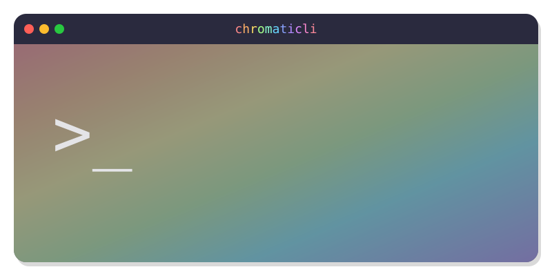

# chromaticli

[](LICENSE)
[](https://github.com/cakeholeDC/chromaticli/actions/workflows/ci.yml)

<p align="center">
  
  <br>
  pronounced <em>chromatically</em> (/kroʊˈmæ.tɪ.kli/).
</p>

chromaticli keeps your editor and terminal in sync by applying matching themes
as you move between project directories.

## Install

### macOS

Install with Homebrew, then wire chromaticli into your shell:

```sh
brew install cakeholeDC/tap/chromaticli
chromaticli install
```

### Linux

Install `git` and `jq` with your distribution's package manager, then clone and
install from the source checkout:

<!-- x-release-please-start-version -->
```sh
git clone --branch v0.2.0 https://github.com/cakeholeDC/chromaticli.git
cd chromaticli
./chromaticli install
```
<!-- x-release-please-end -->

Start a new shell session after installation. chromaticli supports zsh, bash,
and fish. The Linux install uses the repository checkout as its source. If a
shell warns after an upgrade, run the recovery command it prints, then start a
new shell session.

## Use

From a project directory, choose a theme:

```sh
cd ~/my-project
chromaticli set blue
```

This writes the theme selection to `.vscode/settings.json` and applies the
matching palette to the terminal. The hook reapplies it when you enter the
project again. Run `chromaticli list` to browse themes and pairs, or run
`chromaticli set` without an argument to choose interactively.

## Supported Editors

- [Visual Studio Code](https://code.visualstudio.com/)

The bundled VS Code theme pack provides the `chromaticli <color-id>` editor
themes. `chromaticli install` or `chromaticli set` installs the VSIX when the
`code` command line tool is available. Terminal palettes work without the VSIX.

## Themes and terminal behavior

The 23 chromaticli themes cover red, orange, yellow, green, blue, indigo, and
violet, with light and dark variants. The `light` and `dark` defaults are
chromaticli palettes. Eight light/dark pairs are available for automatic
selection. Browse the [theme previews](docs/theme_preview.md).

`themes.json` owns the terminal palettes. The bundled editor themes are kept in
`vscode-extension/` and their integrated terminal colors are generated from
the registry. The shell hook reads the selected theme from the nearest project
`.vscode/settings.json` file and emits OSC color sequences to the terminal.

Individual themes work on macOS and Linux in terminals that support OSC
10/11/12/4. Automatic terminal switching between pair members follows macOS
system appearance. On Linux, pair mode uses the light member. The hook skips
OSC emission inside VS Code and Cursor integrated terminals by default because
those editors control their terminal colors.

## Run from a checkout

Contributors can run the CLI directly without installing it into their home
directory:

```sh
git clone https://github.com/cakeholeDC/chromaticli.git
cd chromaticli
./chromaticli --help
./chromaticli list
./chromaticli set blue --no-install --project ~/my-project
```

`--no-install` skips installing the editor VSIX. To test automatic theme
updates when changing directories, run `./chromaticli install` from the
checkout, then start a new shell. See [CONTRIBUTING.md](CONTRIBUTING.md) for
the full development and theme update process.

## Common commands

| Command | Purpose |
|---|---|
| `chromaticli install` | Configure shell integration. |
| `chromaticli list` | Show themes and light/dark pairs. |
| `chromaticli set <theme>` | Select a theme for the current project. |
| `chromaticli set --pair <pair>` | Select a light/dark pair. |
| `chromaticli preview <theme>` | Preview a theme until the next directory change. |
| `chromaticli unset` | Remove chromaticli theme settings from the current project. |
| `chromaticli uninstall` | Remove shell integration. |

Every command supports `--help`. The only required runtime dependency is
`jq`. The optional `code` CLI installs the bundled VS Code themes; without it,
terminal color sync still works.

## Contributing

Run the shell smoke checks before and after changes:

```sh
./tests/smoke.sh
```

For theme changes, update the registry and editor source, then rebuild and
verify the VSIX and previews:

```sh
python3 scripts/generate-vscode-themes.py
./scripts/update-vsix.sh
python3 scripts/verify-themes.py
python3 tests/verify-bundled-themes.py
python3 scripts/generate-preview.py
```

Commit the generated VSIX and previews with the theme changes. See
[CONTRIBUTING.md](CONTRIBUTING.md) for the detailed checklist, local checks,
and pull request guidance.
