# chromaticli — preview gallery

23 themes in 4 buckets, plus 8 auto pairs. Generated from `themes.json` via `scripts/generate-preview.py`. Pick a card and pass its id to `chromaticli set`.

## Core

| | | |
|---|---|---|
| 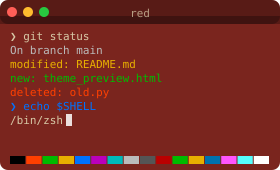 <code>red</code> | 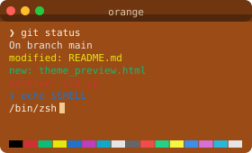 <code>orange</code> | 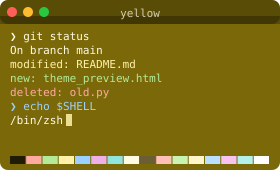 <code>yellow</code> |
| 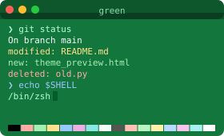 <code>green</code> | 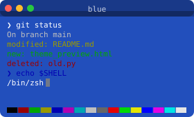 <code>blue</code> | 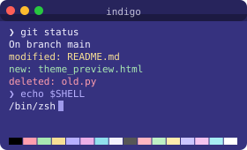 <code>indigo</code> |
| 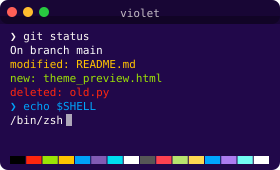 <code>violet</code> |  |  |

## Light

| | | |
|---|---|---|
| 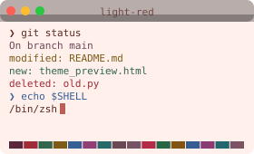 <code>light-red</code> | 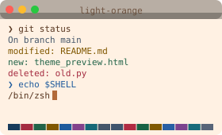 <code>light-orange</code> | 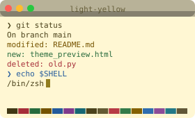 <code>light-yellow</code> |
| 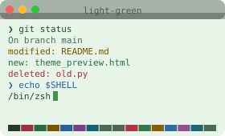 <code>light-green</code> | 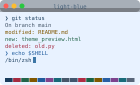 <code>light-blue</code> | 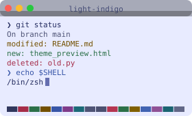 <code>light-indigo</code> |
| 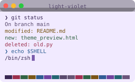 <code>light-violet</code> |  |  |

## Dark

| | | |
|---|---|---|
| 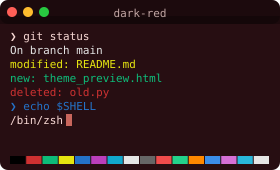 <code>dark-red</code> | 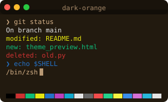 <code>dark-orange</code> | 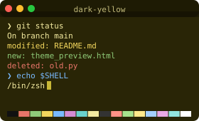 <code>dark-yellow</code> |
| 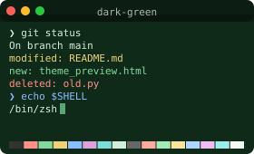 <code>dark-green</code> | 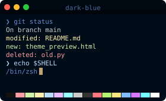 <code>dark-blue</code> | 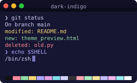 <code>dark-indigo</code> |
| 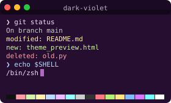 <code>dark-violet</code> |  |  |

## Defaults

| | | |
|---|---|---|
| 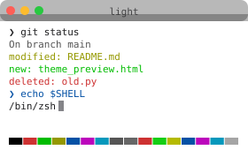 <code>light</code> | 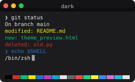 <code>dark</code> |  |

## Pairs (auto light/dark)

Set with `chromaticli set --pair <id>`. On macOS the hook re-evaluates on every prompt and flips when System Settings → Appearance changes. Other OSes currently stick on the light half — see Troubleshooting in the README.

### `default`

| Light | Dark |
|---|---|
|  <code>light</code> |  <code>dark</code> |

### `red-pair`

| Light | Dark |
|---|---|
|  <code>light-red</code> |  <code>dark-red</code> |

### `orange-pair`

| Light | Dark |
|---|---|
|  <code>light-orange</code> |  <code>dark-orange</code> |

### `yellow-pair`

| Light | Dark |
|---|---|
|  <code>light-yellow</code> |  <code>dark-yellow</code> |

### `green-pair`

| Light | Dark |
|---|---|
|  <code>light-green</code> |  <code>dark-green</code> |

### `blue-pair`

| Light | Dark |
|---|---|
|  <code>light-blue</code> |  <code>dark-blue</code> |

### `indigo-pair`

| Light | Dark |
|---|---|
|  <code>light-indigo</code> |  <code>dark-indigo</code> |

### `violet-pair`

| Light | Dark |
|---|---|
|  <code>light-violet</code> |  <code>dark-violet</code> |
